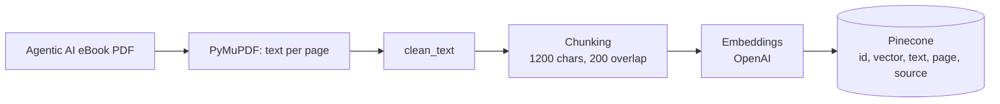
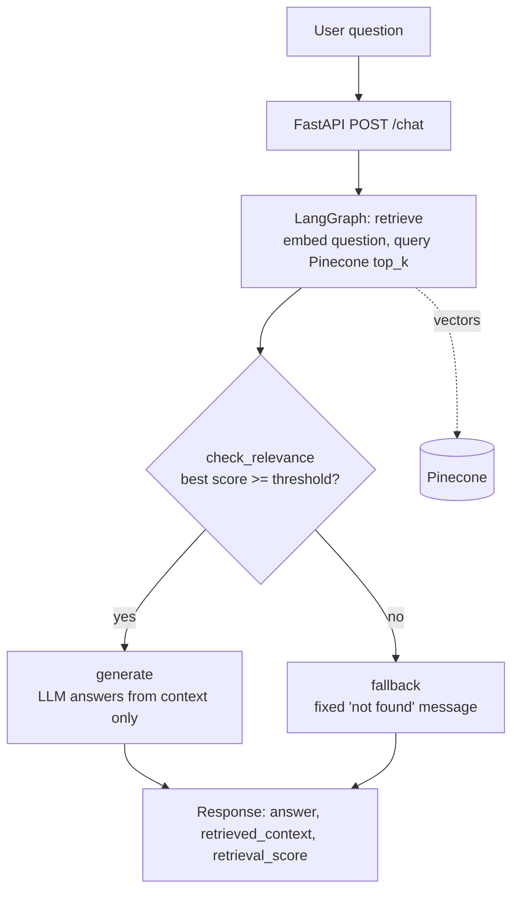

# Architecture

Two separate flows share the same Pinecone index.

## 1. Ingestion (run once, offline)

## 2. Question answering (per request)

## Design notes

- **Why LangGraph:** the workflow has one real decision (answer or refuse). A graph makes that branch explicit and testable instead of an `if` buried inside a function.
- **Why refuse before the LLM:** when retrieval is weak, the LLM is never called, so it cannot answer from general knowledge. The prompt adds a second layer of protection for borderline cases.
- **One page per chunk:** chunks never cross page boundaries, so each chunk has exactly one page number for citation.
